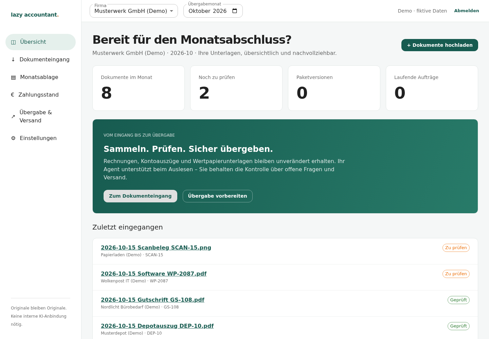
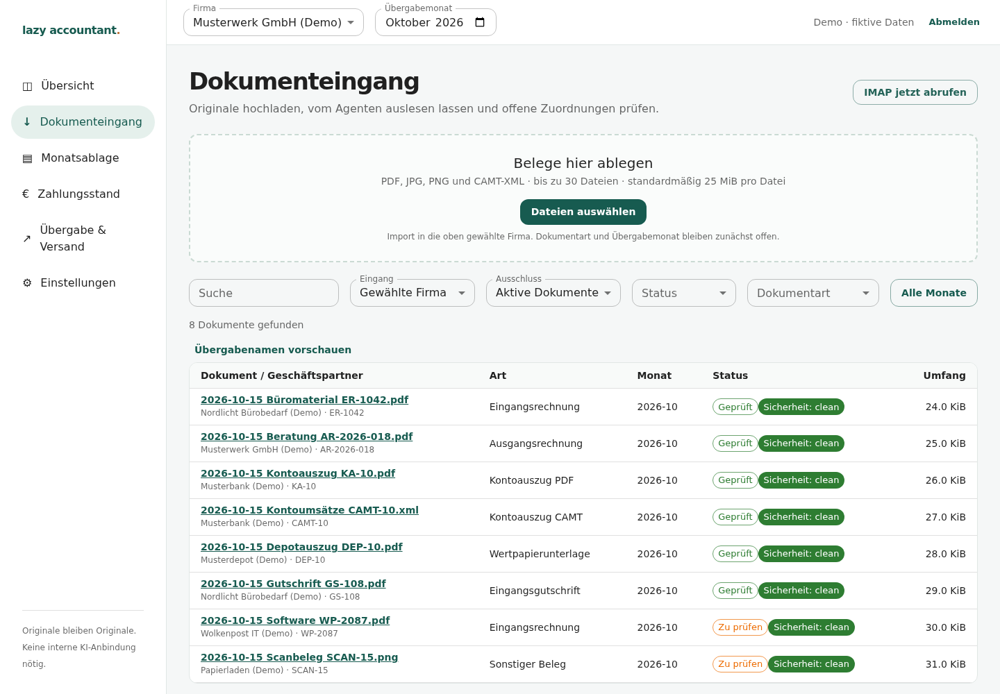
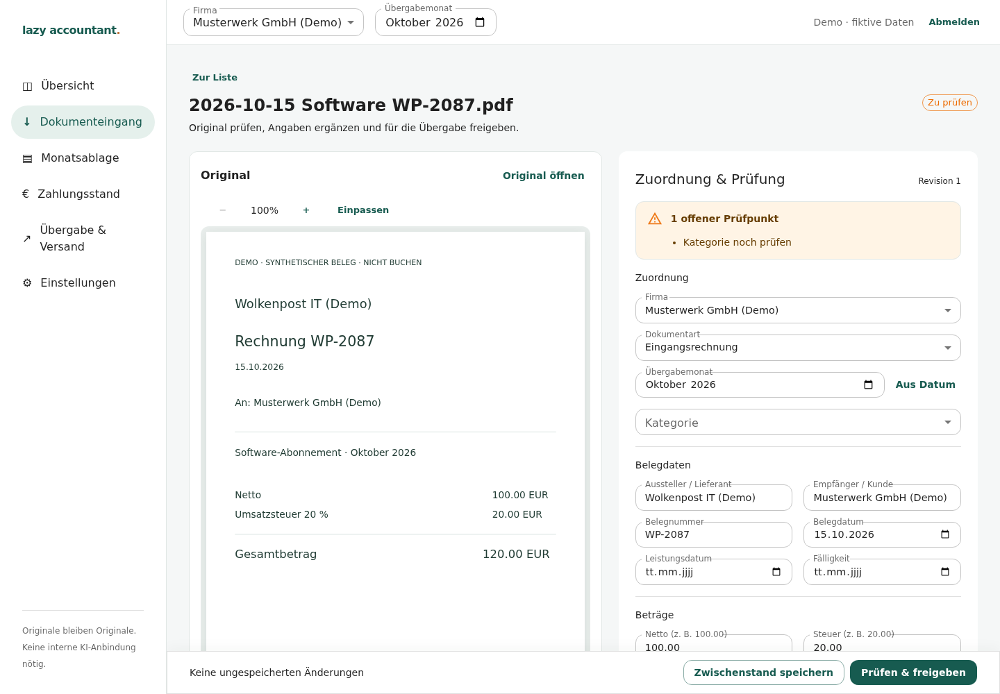
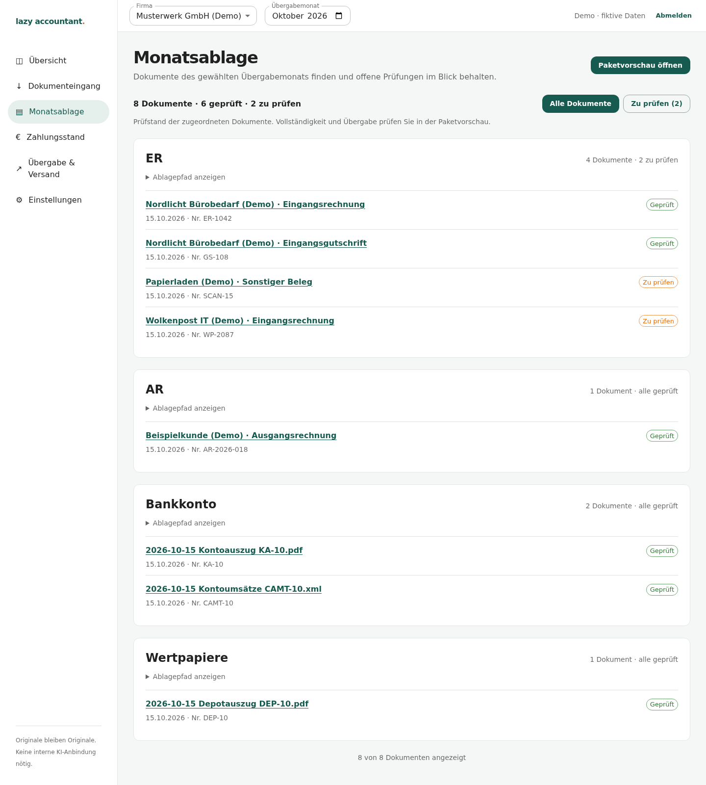
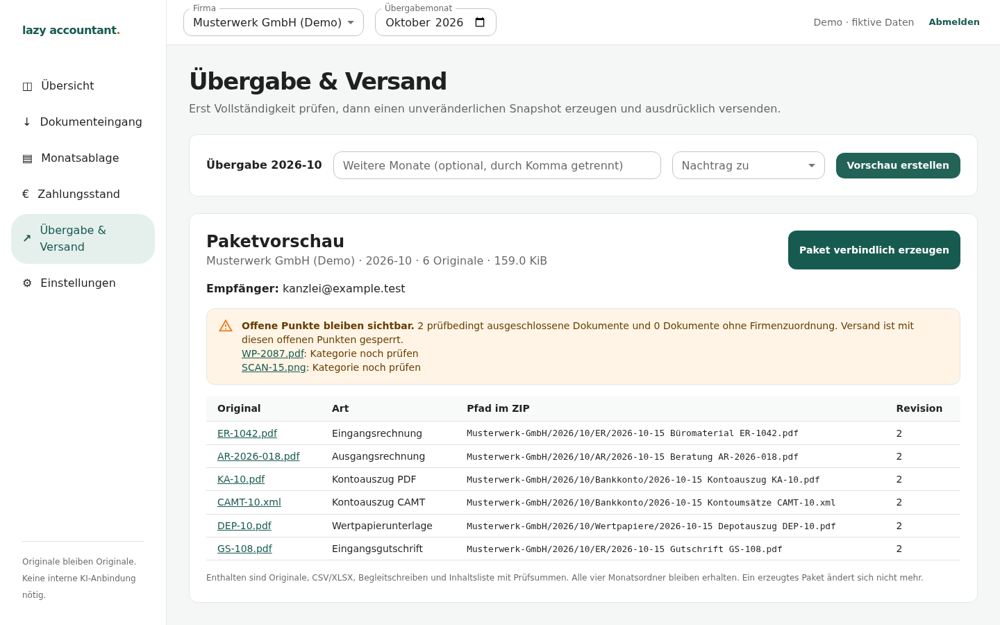

<p></p>

# Lazy Accountant

**Belege automatisch sammeln lassen. Vom gewohnten Agenten bearbeiten lassen. Für die Steuerberatung vorbereiten lassen.**

Lazy Accountant ist die selbst betriebene Dokumentablage und Werkzeugbasis für Ihre agentengestützte Belegvorbereitung. Der eingerichtete IMAP-Abruf sammelt Anhänge aus Ihrem Belegpostfach. Ihren gewohnten MCP-fähigen Agenten beauftragen Sie damit, die Unterlagen auszulesen, zuzuordnen und die Monatsübergabe vorzubereiten — statt jeden Beleg selbst durch eine Oberfläche zu klicken.

Für Selbstständige und kleine Unternehmen, die Belegarbeit delegieren und die eigentliche Buchhaltung ihrer Steuerberatung überlassen möchten. Sie geben den Auftrag und klären Rückfragen; der Agent erledigt die Aufarbeitung innerhalb seiner Berechtigungen. Lazy Accountant hält Originale, strukturierte Ergebnisse, Revisionen und Paketstände nachvollziehbar fest. Mehrere Firmen bleiben getrennt.

**Ihr Agent ist der Arbeitszugang. Die Weboberfläche ist Ihr Überblick und Kontrollpunkt** — für Einrichtung, offene Fälle, Originalvergleich und bei Bedarf manuelle Korrekturen. Sie müssen nicht zusätzlich in einer neuen Chatoberfläche arbeiten. Unterstützt Ihre Agentenumgebung wiederkehrende Aufträge, können Sie die Arbeit dort auch automatisieren: zum Beispiel jeden Montag nach offenen Fällen schauen und berichten lassen.



*UI-Demo mit ausschließlich fiktiven Daten. Alle Screenshots zeigen die echte Oberfläche mit synthetischen API-Antworten; sie sind kein Nachweis eines ausgeführten Imports, Virenscans oder Versands.*

## So arbeiten Sie mit Ihrem Agenten

Sie bleiben im Gespräch mit Ihrem gewohnten Agenten — auch wenn Sie nur wissen möchten, ob noch etwas Ihre Aufmerksamkeit braucht.

*Die folgenden Dialoge sind unabhängige Beispiele mit erfundenen Antworten, keine aufgezeichneten Agentenläufe.*

### „Haben wir Belege, die noch geprüft werden müssen?“

> **Sie:** „Schau bei der Musterwerk GmbH nach: Haben wir noch Belege, die ich prüfen muss?“
>
> **Agent:** „Zwei Belege haben offene Punkte. Bei der Software-Rechnung ist die Zuordnung noch zu klären, beim Scanbeleg kann ich das Belegdatum nicht sicher erkennen. Ich zeige dir beide Belege mit den jeweiligen Rückfragen.“

Nicht erst alle Dokumente öffnen: Lassen Sie sich die offenen Fälle mit Belegverweisen und konkretem Klärungsbedarf zusammenstellen. Der Agent unterscheidet dabei zwischen noch unbearbeiteten Unterlagen und Fällen, die nach seiner Aufarbeitung eine Rückfrage erfordern.

### „Konntest du die Zahlungen zuordnen?“

> **Sie:** „Wie weit bist du mit dem Oktober-Abgleich? Konntest du die Zahlungen den Rechnungen zuordnen?“
>
> **Agent:** „Die eindeutigen Treffer aus dem beauftragten Abgleich sind zugeordnet. Bei einer Rechnung ist erst ein Teilbetrag gedeckt. Eine weitere Zuordnung ist mehrdeutig und bleibt offen. Ich zeige dir die betreffenden Rechnungen, Restbeträge und Bankbewegungen.“

Der Agent kann den gespeicherten Zahlungsstand und Zuordnungskandidaten über MCP abfragen. Ein Abgleich und bestätigte Zuordnungen erfordern einen entsprechenden Bearbeitungsauftrag und die nötigen Rechte. Eine reine Statusfrage ist kein neuer Änderungsauftrag. Grundlage sind die vorhandenen, unterstützten CAMT-Daten — kein Live-Bankzugriff. Automatische Bestätigungen sind auf eindeutige Treffer mit unabhängig verifizierter Gegenpartei/IBAN begrenzt; andere Zuordnungen brauchen eine ausdrückliche Entscheidung. Dafür stehen MCP-Werkzeuge zur Verfügung, kein zusätzlicher mitgelieferter Abgleich-Skill. „Nicht zugeordnet“ bedeutet nicht automatisch „nicht bezahlt“.

### „Arbeite den Eingang auf und frag nur bei Unklarheiten nach.“

> **Sie:** „Arbeite den Dokumenteingang der Musterwerk GmbH auf. Ordne eindeutige Belege zu und gib sie frei, wenn keine Prüfpunkte offen sind. Was du nicht sicher klären kannst, legst du mir gesammelt vor.“
>
> **Agent:** „Ich lese die verfügbaren Belege aus und speichere die eindeutigen Zuordnungen. Unklare Angaben lasse ich offen und fasse die Rückfragen mit Belegverweisen zusammen. Sicherheitsgesperrte Dateien überspringe ich und melde sie separat.“

So delegieren Sie nicht nur das Auslesen, sondern die Aufarbeitung innerhalb eines klaren Auftrags. Originale bleiben unverändert; Ergebnisse und Änderungen werden nachvollziehbar gespeichert.

### „Schau jeden Montag nach und berichte mir, was zu prüfen ist.“

> **Sie, als wiederkehrender Auftrag in Ihrer Agentenumgebung:** „Prüfe jeden Montag den Dokumenteingang der Musterwerk GmbH. Berichte mir, welche Belege noch ungeklärt sind, wo Zahlungszuordnungen offen sind und welche Rückfragen du an mich hast. Nur prüfen und berichten, nichts ändern oder versenden.“
>
> **Agent, im Wochenbericht:** „Diese Woche brauchen zwei Belege deine Rückmeldung. Außerdem ist eine Zahlungszuordnung noch mehrdeutig. Hier sind die betroffenen Unterlagen mit meinen konkreten Fragen. Änderungen oder Versand habe ich nicht ausgelöst.“

**Was Sie Ihrem Agenten einmalig auftragen können, lässt sich auch wiederkehrend ausführen lassen**, sofern Ihre Agentenumgebung zeitgesteuerte Aufträge mit MCP-Zugriff unterstützt. Dort legen Sie Zeitplan, Zeitzone, Firmenumfang, Berechtigungen und Berichtsweg fest — etwa einen montäglichen Kontrolllauf oder die regelmäßige Aufarbeitung des Eingangs. Lazy Accountant stellt dafür Daten, Werkzeuge und nachvollziehbare Ergebnisse bereit; der Zeitplan und die Zustellung des Berichts liegen beim externen Agentensystem. Die Verbindung allein legt noch keine Automatisierung an.

Kontrolle und Bearbeitung bleiben getrennte Aufträge: Für den Wochencheck einen eigenen, auf die betroffenen Firmen beschränkten Token **nur mit `read`** verwenden. Damit sind Änderungen und Versand auch technisch gesperrt, nicht bloß im Prompt untersagt. Der Bericht wird in diesem Fall über die Agentenumgebung ausgegeben; das Speichern eines Agentenberichts in Lazy Accountant benötigt `process`.

Soll der Agent auch aufarbeiten, benötigt er `process` und einen ausdrücklichen Bearbeitungsauftrag mit Regeln für Unklarheiten. Versand braucht zusätzlich `send` und eine gesonderte Autorisierung.

### „Ist der Monat bereit für die Steuerberatung?“

> **Sie:** „Zeig mir die Übergabevorschau für Oktober. Was wäre enthalten, und was ist noch offen? Noch kein Paket erzeugen und nichts versenden.“
>
> **Agent:** „Die Vorschau enthält sechs Originale. Zwei Belege sind wegen offener Prüfpunkte nicht enthalten; nach der hinterlegten Regel ist der Versand deshalb gesperrt. Ich zeige dir den Empfänger und die offenen Fälle. Es wurde nichts versandt.“

Sie können Vorschau, Paketbildung und Versand getrennt beauftragen. Ein Auftrag zur Vorbereitung ist keine Versandfreigabe.

*Illustrative Dialoge mit fiktiven Antworten, keine Protokolle tatsächlich ausgeführter Agentenläufe. Die Beispiele sind voneinander unabhängig; Zahlen und Fälle beschreiben keinen gemeinsamen Live-Datenstand. Der Agent muss seine tatsächliche Antwort aus den zugänglichen Daten und Werkzeugergebnissen ableiten und fehlende Daten oder Rechte ausdrücklich benennen.*

Das sind beispielhafte Nutzeraufträge, keine eingebauten Chatbefehle. Der verbundene Agent bearbeitet sie über MCP-Werkzeuge. Drei mitgelieferte Skills beschreiben die Abläufe für [Dokumenteingang](skills/dokumenteingang-aufarbeiten/SKILL.md), [Konto-/Depotunterlagen](skills/konto-und-depotunterlagen-sortieren/SKILL.md) und [Monatsübergabe](skills/monatsuebergabe-vorbereiten/SKILL.md).

**Was automatisch läuft — und was Sie beauftragen:**

- **Sammlung:** Nach Einrichtung und Aktivierung holt Lazy Accountant Anhänge einmal pro Nacht per IMAP ab. Upload und manueller Abruf bleiben möglich.
- **Bearbeitung:** Ihr externer Agent arbeitet auf Ihren Auftrag über MCP. Wiederkehrende Agentenläufe richten Sie in Ihrer Agentenumgebung ein, etwa in Orca. Ein Import startet nicht von selbst einen Agenten; Lazy Accountant enthält weder ein eigenes LLM noch einen Monatszeitplaner.
- **Kontrolle:** Klare Fälle kann der berechtigte Agent strukturiert speichern und ohne offene Prüfpunkte freigeben. Unklarheiten bleiben sichtbar; manuelle Korrekturen werden nicht still überschrieben.
- **Versand:** Benötigt einen ausdrücklichen Auftrag und das gesonderte Versandrecht — auch wenn der Agent die Vorbereitung übernimmt.

## Was dabei in Lazy Accountant entsteht

Die Screenshots zeigen Ablage, Ergebnisse und offene Fälle, nicht eine verpflichtende Klickstrecke. Sie illustrieren keinen ausgeführten Agentenlauf.

### 1. Ein gesammelter Dokumenteingang

Anhänge aus dem eingerichteten Belegpostfach landen im Eingang. PDFs, JPG/PNG und CAMT-XML lassen sich zusätzlich hochladen. Ihr Agent kann den Abruf auch ausdrücklich anstoßen und den Eingang über MCP aufarbeiten. Dokumente ohne sichere Firmenzuordnung bleiben zunächst im persönlichen Eingang.

Neue Dateien werden erst nach erfolgreicher lokaler Malwareprüfung für Agentenbearbeitung und Dateizugriff freigegeben. Gesperrte Dateien bleiben sichtbar.



### 2. Ausgelesene Angaben und gezielte Rückfragen

Über MCP liest Ihr Agent Dokumenttext und bei Bedarf Seitenbilder, ordnet Firma, Belegart, Monat und Rechnungsdaten zu und speichert validierte Ergebnisse. Kann er etwas nicht eindeutig klären, hält er offene Punkte fest, statt Angaben zu erfinden. Bewusste Nichtbeleg-Ausschlüsse erfolgen nur auf autorisierten Auftrag und bleiben reversibel.

Wenn Sie selbst nachsehen möchten, zeigt die Weboberfläche Original und Prüfdaten nebeneinander. Sie können gezielt Rückfragen klären oder Angaben korrigieren, statt jeden Beleg von Hand zu erfassen.



*Die Belegvorschau ist ein synthetisches SVG, keine aus einer echten PDF gerenderte Seite. „Kategorie noch prüfen“ ist ein beispielhafter offener Prüfpunkt, kein generelles Pflichtfeld.*

### 3. Eine nachvollziehbare Monatsablage

Die vom Agenten gespeicherten Zuordnungen führen Ihre Unterlagen in die Monatsablage: Eingangsrechnungen, Ausgangsrechnungen, Bankkonto und Wertpapiere. Sie sehen den erreichten Prüfstand und verbleibende Ausnahmen. Lesbare Übergabenamen helfen beim Wiederfinden; die Originalnamen bleiben nachvollziehbar.

<details>
<summary>Monatsablage ansehen</summary>



</details>

### 4. Eine vorbereitete Übergabe statt manueller Paketarbeit

Ihr Agent kann über MCP die Paketvorschau abrufen, offene Punkte berichten und auf Auftrag die Paketbildung anstoßen. Lazy Accountant erzeugt das ZIP mit Originalen und einer Excel-Arbeitsmappe mit acht Blättern, darunter Zahlungszuordnungen, Bankbewegungen und eine Inhaltsliste mit Originalprüfsummen. [Format und Grenzen](docs/HANDOVER_WORKBOOK.md). Ein erzeugtes Paket bleibt unverändert; spätere Korrekturen verändern keine bereits gespeicherten Paketstände. Inhalt, Empfänger und offene Punkte sind auch in der Weboberfläche einsehbar.

Mit gesondertem Versandrecht und ausdrücklichem Auftrag kann der Agent den gespeicherten Paketstand per SMTP versenden; alternativ nutzen Sie die Oberfläche. Eine SMTP-Annahme ist keine Zustellbestätigung. Ein unbekannter Versandausgang wird nicht automatisch erneut gesendet.



*Die Demo zeigt bewusst keinen „alles erledigt“-Zustand: Zwei Unterlagen sind noch zu prüfen und nicht im Paket enthalten; der Versand ist nach der dargestellten Regel gesperrt. Es wurde kein ZIP erzeugt und keine E-Mail versandt.*

## Was außerdem hilft

- **Zahlungsstand nachvollziehen:** Unterstützte CAMT-Kontoumsätze mit importierten Rechnungen abgleichen; Teilzahlungen und manuelle Zuordnungen berücksichtigen. Kein vollständiges Banking und kein Mahnversand. [Umfang und Grenzen](docs/BANK_RECONCILIATION.md).
- **Zugriff passend begrenzen:** MCP-Token auf benötigte Firmen und Rechte beschränken. Aufarbeitung und Versand sind getrennte Berechtigungen; Token lassen sich widerrufen. [Agentenanbindung und Rechte](docs/MCP.md).
- **Selbst betreiben:** Dokumentablage und lokaler Virenscanner laufen in Ihrer Infrastruktur. Der Virenscanner benötigt Internetzugriff für Signaturupdates; Dokumentinhalte werden dabei nicht übertragen. Mailversand und eine von Ihnen konfigurierte externe Agentenanbindung sind weitere Datenübertragungen — „self-hosted“ bedeutet nicht automatisch „keine Daten verlassen das System“.

## Ausprobieren und selbst betreiben

Der Einstieg erfolgt mit Docker Compose. Sie benötigen Docker Engine mit Compose-Plugin, Python 3 für die einmalige Konfiguration und ungefähr 6 GiB RAM für den Stack einschließlich ClamAV.

```sh
python3 scripts/init-env.py
# .env lokal prüfen; das erzeugte ADMIN_PASSWORD nicht weitergeben.
docker compose up --build -d --wait --wait-timeout 900
```

Danach öffnen Sie **http://localhost:8000/** und melden sich mit `admin` und dem Passwort aus Ihrer privaten `.env` an. Für den agentengestützten Arbeitsmodus richten Sie einmalig ein:

1. **Firma und Ablage:** Konten/Depots, Kategorien und Steuerberatungsempfänger unter **Einstellungen** hinterlegen.
2. **Automatische Sammlung:** IMAP-Postfach samt Importbeginn konfigurieren und den nächtlichen Abruf aktivieren.
3. **Gewohnten Agenten verbinden:** Unter **Einstellungen → Agent / MCP** einen firmenbeschränkten Token mit den benötigten Rechten erzeugen. Den erreichbaren Endpunkt `http://<interner-host>:8000/mcp/` und den geheimen Bearer-Token in Ihrem MCP-fähigen Client konfigurieren; Host-/Origin-Freigaben beachten. Keine Zugangsdaten in Prompts oder ins Repository kopieren.
4. **Arbeit delegieren:** Die mitgelieferten Skills im Agenten verfügbar machen und einen ersten Aufarbeitungsauftrag erteilen. Für wiederkehrende Bearbeitung den Lauf in Ihrer externen Agentenumgebung einrichten. Versand nur gesondert autorisieren.

Der Client muss **Streamable HTTP**, einen konfigurierbaren **`Authorization: Bearer`-Header** und für die visuelle Auslese von Scans **Bildinhalte aus MCP-Werkzeugen** unterstützen. Der interne Host muss aus der Agentenumgebung erreichbar sein. Eine reine stdio-Anbindung genügt für diesen Endpunkt nicht.

Die genaue Client-Konfiguration und Live-Prüfung hängen von Ihrer Agentenumgebung ab. Die produktive Anbindung mit dem tatsächlich verwendeten Agenten — auch bei Orca — ist laut aktuellem Projektstand noch live abzunehmen; die Beispiele sind keine Kompatibilitätszusage für beliebige Clients. [MCP-Einrichtung, Skills und Berechtigungen](docs/MCP.md).

**Wichtig:** Standardmäßig wird Port 8000 an allen Host-Schnittstellen veröffentlicht. Für ausschließlich lokalen Zugriff setzen Sie vor dem Start `HTTP_BIND=127.0.0.1` in `.env`. Kein öffentlicher Betrieb über unverschlüsseltes HTTP. Für LAN-Zugriff müssen Host-/Origin-Freigaben explizit passen; Backups und Schlüsselaufbewahrung gehören zum eigenen Betrieb.

[Vollständige Startanleitung, Demo-Monat und Entwicklung](docs/GETTING_STARTED.md) · [Betrieb und Backup/Restore](docs/OPERATIONS.md) · [Malwareprüfung und Sicherheitsgrenzen](docs/SECURITY.md).

## Bewusster Umfang

Lazy Accountant bereitet Unterlagen vor. Es ersetzt **keine vollständige Buchhaltung, keine Steuerberatung und keine steuerliche Wertpapierberechnung**. Eigene Rechnungen erstellen, wiederkehrende Rechnungen, Projekte und Zeiterfassung gehören nicht zum hier beschriebenen Funktionsumfang.

Auch mit nachvollziehbaren Revisionen und unveränderten Paketständen wird hier keine rechtliche Revisionssicherheits- oder Compliance-Zusage gemacht. Selbstbetrieb erfordert sichere Konfiguration, laufende Pflege und geprüfte Backups.

## Weiterführende Dokumentation

| Thema | Einstieg |
| --- | --- |
| Installation, Beispielmonat und Entwicklung | [Technischer Einstieg](docs/GETTING_STARTED.md) |
| Betrieb und Wiederherstellung | [Betrieb](docs/OPERATIONS.md) |
| Quarantäne und Malwareprüfung | [Sicherheit](docs/SECURITY.md) |
| Agenten, MCP und Berechtigungen | [MCP](docs/MCP.md) |
| Zahlungsstand und CAMT-Abgleich | [Bankabgleich](docs/BANK_RECONCILIATION.md) |
| Unterstützte CAMT-Formate | [CAMT](docs/CAMT.md) |
| Fremdwährungszuordnung | [Fremdwährungsdeckung](docs/fx-reconciliation.md) |
| Nichtbelege begründet ausschließen | [Dokumentausschlüsse](docs/DOCUMENT-EXCLUSIONS.md) |
| Lesbare Übergabenamen | [Übergabenamen](docs/HANDOVER_NAMES.md) |
| Inhalt und Grenzen der Excel-Übergabe | [Übergabe-Arbeitsmappe](docs/HANDOVER_WORKBOOK.md) |
| Laufzeiten und ausgeführte Abnahmen | [Versionen](docs/VERSIONS.md) · [Implementierungsprotokoll](docs/IMPLEMENTATION.md) |
| Planung und spätere Etappen | [Plan](docs/PLAN.md) |
| Herkunft der Produktbilder und des Logos | [Screenshots](docs/screenshots/README.md) · [Logo](docs/brand/README.md) |

Technische Basis: Django/DRF, PostgreSQL und React/TypeScript. Details zu Laufzeiten, Tests und Schnittstellen stehen in der technischen Dokumentation, nicht im Mittelpunkt dieses Produkteinstiegs.
