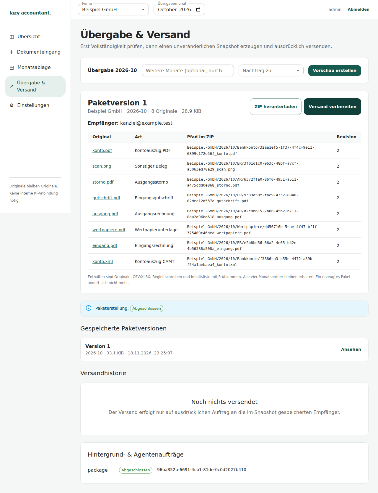

# Lazy Accountant

Selbst betriebene, deutschsprachige Webanwendung für Dokumenteingang und Monatsübergabe an die Steuerberatung. **Etappe 1 aus [Issue #1](https://github.com/pfriedrich84/lazy-accountant/issues/1)**: getrennte Firmen, Originalablage, Prüfung, IMAP, unveränderliche ZIP-Pakete, SMTP, authentifiziertes MCP und drei Agenten-Skills.

Django/DRF + PostgreSQL · React/TypeScript mit React Router Framework-SPA, Material UI und TanStack Query · Django-Q2 mit ORM-Broker · offizielles MCP Python SDK v2. **Keine serverseitige LLM-Anbindung, kein eigener Monatszeitplaner.** Orca startet den externen Agenten.

## Start mit Docker Compose

Voraussetzung: Docker Engine mit Compose-Plugin und Python 3 zum einmaligen Erzeugen der Konfiguration. Docker legt die benannten Volumes für PostgreSQL und Dokumente selbst an; kein Host-Ablageordner ist nötig. Der Web-/API-/MCP-Port **8000 wird am Host veröffentlicht** (`0.0.0.0:8000`); der Datenbankport bleibt intern.

```sh
python3 scripts/init-env.py
# .env lokal prüfen. ADMIN_PASSWORD steht ausschließlich dort.
docker compose up --build -d --wait
```

Oberfläche: **http://localhost:8000/** · Benutzer `admin`, Passwort aus `.env`. Django Admin zusätzlich unter `/admin/`. Zugangsdaten nie in Git/Chat/Buildprotokolle kopieren. `init-env.py` überschreibt keine bestehende Konfiguration und erzeugt nur die private `.env`. App und Worker teilen das Dokumentvolume unter `/data` und laufen als Benutzer `1000:1000`; Docker übernimmt beim erstmaligen Anlegen dessen private Verzeichnisrechte aus dem Image.

Der Start führt Migrationen und Bootstrap idempotent aus. App und separater Worker verwenden dieselbe Codebasis; PostgreSQL ist die persistente Queue. Firmen, Konten/Depots, Kategorien, Empfänger, Mailzugänge und Agententoken sind über **Einstellungen** konfigurierbar.

Für das private LAN `ALLOWED_HOSTS`, `CSRF_TRUSTED_ORIGINS`, `MCP_ALLOWED_HOSTS` und `MCP_ALLOWED_ORIGINS` in `.env` **explizit** um die tatsächliche interne Server-IP oder den Hostnamen ergänzen, einschließlich Port bei den Origins/MCP-Hosts. Die Veröffentlichung des Ports hebt die Host-/Origin-Prüfung nicht auf. `HTTP_PORT` ändert den Host-Port, `HTTP_BIND=127.0.0.1` beschränkt ihn wieder auf lokalen Zugriff. Bestehende `.env` mit `HTTP_BIND=127.0.0.1` für LAN-Zugriff bewusst auf `0.0.0.0` oder die interne Server-IP ändern. Kein öffentlicher Betrieb über unverschlüsseltes HTTP; Firewall/private Netzgrenze beachten. Domain/TLS sind für den vereinbarten internen Start nicht erforderlich.

### Dockhand

Als Git-Stack aus `main` mit `compose.yaml` und Build-Kontext Repository-Wurzel deployen; beim Update erneut bauen. Die privaten Konfigurationswerte aus `.env` in Dockhand übernehmen (alternativ `.env.example` mit frisch erzeugten starken Secrets ausfüllen). Kein `DOCUMENTS_ROOT`, kein Host-`chown` und keine Anpassung an die Benutzer-ID des Docker-Hosts nötig. Docker erzeugt die Volumes `documents` und `postgres` mit dem Stack-Projektpräfix. Für einen späteren Netzwerkspeicher nur die Definition des Dokumentvolumes ändern, nicht den Anwendungspfad `/data`; vorhandene Daten vorher konsistent migrieren, siehe [Betrieb](docs/OPERATIONS.md#dokumentvolume-und-späterer-netzwerkspeicher).

## Erster Ablauf

1. Firma anlegen, sicheren eindeutigen Ordnernamen wählen; Konto/Depot, Kategorien und Steuerberater-Empfänger hinterlegen.
2. PDFs, JPG/PNG und CAMT-XML im **Dokumenteingang** hochladen. Ungeklärte Firma bleibt im persönlichen Eingang. Der Import rät keinen endgültigen Übergabemonat.
3. Eindeutige Nichtbelege über „Als Nichtbeleg ausschließen“ mit Grund reversibel aus dem aktiven Eingang entfernen; im Ausschlussfilter wiederfinden und wiederherstellen. Keine Original-Löschung, keine automatische Dateinamenregel. Bestehende Pakete bleiben unverändert, neue Pakete weisen bewusste Ausschlüsse separat aus. [Vertrag und Upgradehinweise](docs/DOCUMENT-EXCLUSIONS.md).

   Dokument öffnen: Originalseite neben Metadaten prüfen, Art/Firma/Monat/Konto zuordnen. Zwischenspeichern ist mit offenen Punkten möglich; Freigabe nur ohne Validierungsfehler. Geldbeträge als Dezimalstrings mit Punkt eingeben. Quartals-/Mehrmonatsauszüge behalten ihren echten Zeitraum; die Zuordnung zu einem Übergabemonat ausdrücklich mit Begründung bestätigen.
4. Unter **Monatsablage** die echte Ordnerstruktur im Dokumentvolume prüfen. Alle vier Unterordner bleiben erhalten:

   ```text
   Firma/Jahr/Monat/ER/
   Firma/Jahr/Monat/AR/
   Firma/Jahr/Monat/Bankkonto/
   Firma/Jahr/Monat/Wertpapiere/
   ```

5. Unter **Übergabe & Versand** Vorschau prüfen und Paket verbindlich erzeugen. ZIP enthält Originale, CSV, XLSX, Begleitschreiben und Inhaltsliste mit Prüfsummen. Fehlende/ausgeschlossene Unterlagen und Empfänger bleiben sichtbar.
6. Optional unter **Einstellungen → IMAP & SMTP** das Belegpostfach samt Importbeginn einrichten und **nächtlichen IMAP-Abruf** aktivieren. Automatischer Start einmal pro Nacht ab **03:00 Uhr Europe/Vienna**; große Rückstände werden in begrenzten Teilabrufen abgearbeitet. Manueller Abruf bleibt jederzeit möglich. Importierte Anhänge starten noch keinen KI-Agenten automatisch.
7. SMTP konfigurieren und den gespeicherten Snapshot ausdrücklich versenden. `SMTP angenommen` ist **keine bestätigte Zustellung**. Ein unbekannter Ausgang wird nicht automatisch erneut gesendet; Neuversand ist eine erkennbare, protokollierte Aktion.

<details>
<summary>Screenshot aus dem tatsächlichen synthetischen Compose-Browsertest</summary>



</details>

Originalbytes bleiben unverändert; Ausleseergebnisse sind getrennte, revisionsgeschützte Metadaten. Monatskorrekturen ändern die echte Ablage, aber niemals bereits erzeugte Paket-Snapshots. Nachträge verweisen auf Vorgänger und berücksichtigen deren Revisionsstände.

**Lesbare Übergabenamen** werden separat aus strukturierten Belegdaten erzeugt und für neue ZIPs, CSV/XLSX, Inhaltsliste und Einzel-Downloads verwendet – ohne standardmäßiges UUID-Präfix. Originalnamen bleiben sichtbar. Manuelle Namen sind versioniert und vor erneuter Agentenverarbeitung geschützt. Bestandsnamen nur nach Vorschau ausdrücklich übernehmen; bestehende Pakete bleiben unverändert. Details und REST-/MCP-Aufrufe: [Übergabenamen](docs/HANDOVER_NAMES.md).

## Synthetischer Beispielmonat

```sh
docker compose exec app python backend/manage.py bootstrap \
  --demo --sample-month 2026-10 --output /data/samples
# Optional: mit --classified die synthetischen Metadaten bereits freigeben.
```

Zwei getrennte Firmen mit **je acht Dokumenten**, Bankkonto/Depot, Kategorien sowie AR, ER, Gutschrift, Storno, CAMT + Auszugs-PDF, Wertpapier-PDF und Scanbeleg. Wiederholtes Bootstrap erzeugt keine Dubletten. Im Dokumentvolume unter `/data/samples/` liegen zusätzlich die Uploaddateien der ersten Firma, im Unterordner `Zweite-Firma/` diejenigen der zweiten Firma. Bei Bedarf auf den Host kopieren: `docker compose cp app:/data/samples/. ./var/samples/` (Zielordner vorher anlegen).

Ein vollständig automatisierter, **echter MCP-/IMAP-/SMTP-Test** benötigt nur das mitgelieferte kontrollierte Mail-Testprofil, keine produktiven Mailzugänge:

```sh
docker compose --profile test-mail up -d --wait
uv sync --locked
uv run python scripts/mcp_client.py --exercise --mail --report var/smoke-report.json
```

Der Client legt ausschließlich eine neue synthetische Firma an, importiert mehrere Anhänge über echten IMAP, liest/klassifiziert alle Dokumentarten über MCP, erzeugt das ZIP im separaten Worker und verifiziert SMTP-Mailteile durch Rücklesen vom Testpostfach. Der temporäre MCP-Token wird anschließend widerrufen. GreenMail läuft nur im optionalen Profil; Testports 3025/3143 sind an Loopback gebunden.

## MCP und Skills für Orca

Unter **Einstellungen → Agent / MCP** einen firmenbeschränkten Token mit benötigten Funktionsrechten erzeugen. Für den Eingang ohne Firmenzuordnung zusätzlich `inbox`, für autorisierten Versand zusätzlich `send` vergeben.

- Streamable HTTP: `http://<interner-host>:8000/mcp/`
- Header: `Authorization: Bearer <Token>`
- Derselbe Header schützt Original-/Seiten- und Paketdownloads.
- Host/Origin explizit erlauben; kein anonymer MCP-Zugriff.

```sh
# Token sicher als Umgebungsvariable setzen, nicht als CLI-Argument:
uv run python scripts/mcp_client.py --url http://localhost:8000
# Liest LA_MCP_TOKEN; ohne --exercise nur Discovery/Firmenabfrage.
```

Die versionierten Skills unter `skills/<name>/SKILL.md` sind agentenunabhängige ausführbare Werkzeugabläufe:

- `dokumenteingang-aufarbeiten`
- `konto-und-depotunterlagen-sortieren`
- `monatsuebergabe-vorbereiten`

Details zu Schemas, Auftrags-/Idempotenz-IDs, Berechtigungen, Lifecycle und Client: **[docs/MCP.md](docs/MCP.md)**. Orca-Zeitpunkt/Job und produktive Verbindung werden später in Orca eingerichtet; die Anwendung enthält keinen Monats-Cronjob.

## Tests und lokale Entwicklung

Aktuelle gepinnte Laufzeiten: **Python 3.15.2**, **Node 26.13.1**, **PostgreSQL 18.7**. Für lokale Entwicklung/den SDK-Test zusätzlich `uv 0.13.9` und Node bereitstellen; `.python-version`/`.node-version` halten die Laufzeitwahl fest. `uv sync` kann die passende Python-Version selbst installieren. Release-/Kompatibilitätsprüfung: [docs/VERSIONS.md](docs/VERSIONS.md).

```sh
uv sync --locked
uv run ruff check backend scripts
uv run pytest -q
uv run python backend/manage.py makemigrations --check --dry-run
cd frontend
npm ci
npm run typecheck
npm test
npm run build
```

Ohne `POSTGRES_HOST` verwenden lokale Tests/Entwicklung ausdrücklich SQLite als Fallback, **nicht** der Compose-Betrieb. Für PostgreSQL-Tests `POSTGRES_HOST`, `POSTGRES_PORT`, `POSTGRES_DB`, `POSTGRES_USER` und `POSTGRES_PASSWORD` setzen. Der Testbenutzer braucht `CREATEDB`. Die CI prüft PostgreSQL, Frontend, tatsächliches Compose, MCP/Mail, Browser, Worker-Neustart und Backup/Restore.

Lokaler ASGI-Betrieb nach `migrate`, `bootstrap` (erstmalig `ADMIN_PASSWORD` setzen) und Frontendbuild:

```sh
mkdir -p var/documents
uv run python backend/manage.py migrate
ADMIN_PASSWORD='<lokales langes Passwort>' uv run python backend/manage.py bootstrap --demo
PYTHONPATH=backend uv run uvicorn config.asgi:application --host 127.0.0.1 --port 8000
# In separatem Terminal mit derselben Umgebung:
uv run python backend/manage.py qcluster
```

Frontend-Hot-Reload optional mit `npm run dev`; Vite proxyt `/api` an Port 8000. Für den integrierten Browser-Smoke zuerst synthetische Uploaddateien unter `var/samples` erzeugen, dann:

```sh
uv run python backend/manage.py bootstrap --sample-month 2026-10 --output var/samples
cd frontend
npx playwright install chromium
ADMIN_PASSWORD='<lokales Passwort>' npm run test:browser
```

## Betrieb, Datensicherheit und Grenzen

- **[Betrieb und Backup/Restore](docs/OPERATIONS.md)**: gemeinsame Offline-Sicherung von PostgreSQL, Originalen, Snapshots, Mailteilen und Schlüssel; Integritätsprüfung und sicherer Wiederanlauf.
- **[Reversibler Nichtbeleg-Ausschluss](docs/DOCUMENT-EXCLUSIONS.md)**: MCP/REST, UI, Rechte, Idempotenz, Paket-/Nachtragsverhalten und Migration/Rollback.
- **[CAMT-Unterstützung](docs/CAMT.md)**: explizite Namespaces, sichere XML-Verarbeitung und sichtbare Fehler ohne Originalverlust.
- **[Implementierungs-/Abnahmeprotokoll](docs/IMPLEMENTATION.md)**: tatsächlich ausgeführte Prüfungen, Umgebungshindernisse und verbleibende Live-Einrichtung.
- **[Verbindlicher Plan und spätere Roadmap](docs/PLAN.md)**.

Dies ist eine Unterlagenvorbereitung, keine vollständige Buchhaltung oder steuerliche Wertpapierberechnung. Eigene Rechnungen, Wiederholungsrechnungen, Bankabgleich, Projekte und Zeiten sind spätere Etappen. Echte Firmen-/Maildaten, interne Speicher-/Serveradressen und die Live-Orca-Anbindung sind Einrichtungsparameter, keine Voraussetzung für synthetische Entwicklungstests.
